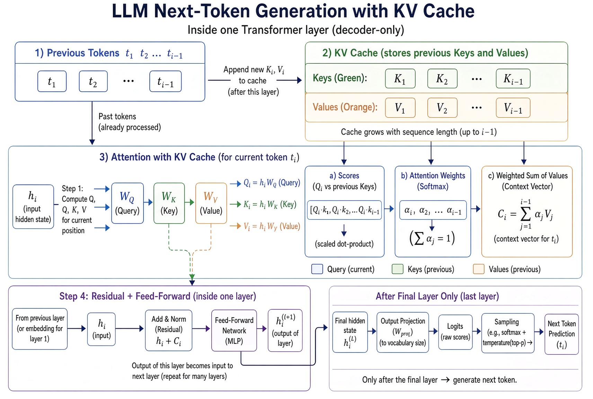

# LoRA Lab

This project fine-tunes an open Qwen3 model with LoRA. It is for developers, and for anyone who wants to understand LLM inference at a high level.

An API call is easy to write. It is harder to see what the model does during that call. This project shows that work. It trains a small adapter on a toy catalog. It then asks the same questions to the base model and to the base model plus the adapter. Read this file together with `configs/smoke.yaml`. The module names in that file are the matrices in the sections below.

Run the training on a PC with an NVIDIA RTX GPU. This project was tested on an RTX 5080 with 16 GB of memory. Other RTX cards use the same commands. Copy this folder to that PC. The code uses Hugging Face Transformers, PEFT, and TRL. Training does not change the base weights. It updates a few small matrices and saves them as an adapter. The adapter is tens of megabytes.

> [!IMPORTANT]
> This README assumes you know the basic operations on matrices and vectors. The explanation is a high-level picture. It does not explain, in detail, the purpose of each layer inside the model.

## What the model is doing

An LLM writes one token at a time. The next token depends on every token in the prompt and on every token the model has already written. The model checks how relevant each of those tokens is. It does that with a series of matrix multiplications.

Qwen3 repeats those multiplications in a stack of layers. The figure shows one layer during one step. The legend defines the symbols. The list then follows the same step.



Legend:

- \(t_i\) is a token. It is the last token of the prompt, or a token the model just wrote. This step reads \(t_i\) and generates the next token. \(t_1\) through \(t_{i-1}\) are the tokens before \(t_i\).
- \(h_i\) is a vector. It is the hidden state of \(t_i\), not the token text.
- \(W_Q\), \(W_K\), and \(W_V\) are matrices. The layer multiplies the vector \(h_i\) by each of them.
- \(Q_i\), \(K_i\), and \(V_i\) are vectors. They are the Query, Key, and Value for token \(t_i\). \(Q_i = h_i W_Q\). The same pattern gives \(K_i\) and \(V_i\). The Query is what this position looks for. The Key is what it offers for a match. The Value is the information it can pass on.
- \(K_1\) through \(K_{i-1}\) and \(V_1\) through \(V_{i-1}\) are vectors. They are the Keys and Values already stored for the earlier tokens. This layer does not compute them again.
- \(Q_i · K_j\) is a number. It measures how relevant token \(t_j\) is to \(t_i\).
- \(\alpha_j\) is a number. It is the weight for token \(t_j\) after softmax. The weights sum to 1.
- \(C_i\) is a vector. It is the context vector, the mix of the Value vectors, using those weights.
- \(h_i^{(l+1)}\) is a vector. It is the output of this layer. The next layer reads it as its input.
- \(h_i^{(L)}\) is a vector. It is the hidden state after the last layer.
- \(W_{proj}\) is a matrix. It turns \(h_i^{(L)}\) into one score for each token in the vocabulary.

The same step, in the order of the boxes in the figure:

**1) Previous Tokens**

- Tokens \(t_1\) through \(t_{i-1}\) already went through this layer. This layer does not compute them again.

**2) KV Cache**

- The KV cache stores the Key and the Value for each of those tokens. Each new token adds one pair. The cache does not store the Query.

**3) Attention with KV Cache**

- The hidden state of \(t_i\) is the vector \(h_i\). The layer multiplies that vector by three matrices: \(W_Q\), \(W_K\), and \(W_V\).
- The Query is what this position looks for. The Key is what this position offers for a match. The Value is the information this position can pass on. The new Key and the new Value go into the cache for the next token.
- The layer scores the Query against the Keys with a scaled dot product. Softmax turns the scores into weights. The weights sum to 1. The weights mix the Values into one context vector.
- The mix includes the current position and every cached position. One more matrix changes the mix back to the size of \(h_i\).

**4) Residual + Feed-Forward**

- The layer adds the context vector to \(h_i\). The feed-forward network then runs on this position only.
- The layer adds the feed-forward output back onto the vector. That sum is the input of the next layer.

The model repeats boxes 1 through 4 for every layer. Each layer has its own \(W_Q\), \(W_K\), and \(W_V\), and its own KV cache. The vector that leaves one layer is the \(h_i\) of the next layer.

**5) After the final layer**

- This box runs once, after the last layer.
- The final hidden state is one vector. The output matrix turns that vector into one score for every token the model is allowed to write. That fixed list of tokens is the vocabulary.
- The highest score chooses the next token. This project always takes that highest score. The choice is a token id, not a vector.
- The model finds that token's row in the embedding matrix. That row is the vector for the new token. It is the input when the model runs boxes 1 through 4 again, once per layer, to write the token after that.

## What LoRA is doing

The section above shows how inference works. This section fine-tunes that same model with LoRA.

LoRA keeps the base model. It adds small extra matrices beside the pretrained matrices. Inference still follows the same steps. The extra matrices make a small change to the vectors in those steps. Training updates only the extra matrices. The base weights stay frozen. The file that training saves is the adapter.

Training does not change the Query, Key, and Value calculation. It learns a small change to seven matrices: `q_proj`, `k_proj`, `v_proj`, `o_proj`, `gate_proj`, `up_proj`, and `down_proj`.

These are the matrices from the previous section, under the names in this project. `q_proj`, `k_proj`, and `v_proj` are \(W_Q\), \(W_K\), and \(W_V\). `o_proj` changes the mixed values back to the size of \(h_i\). `gate_proj`, `up_proj`, and `down_proj` are the feed-forward matrices. The embedding table and the output matrix stay frozen.

Each pretrained matrix stays frozen. The extra matrix beside it is much smaller. During inference, the layer adds the two together.

A change in `q_proj`, `k_proj`, or `v_proj` changes the Query, Key, or Value. A change in `o_proj` or the feed-forward matrices changes what the layer does with those vectors. The layer structure stays the same.

This guide uses `configs/smoke.yaml`. That file trains `Qwen/Qwen3-0.6B` on the toy catalog. `configs/qwen3-4b-qlora.yaml` does the same training on the larger 4B instruct model, for a 16 GB GPU.

## Set up the GPU

Run training on a PC with an NVIDIA RTX GPU. These steps were tested on an RTX 5080 with 16 GB of memory. The setup script is `scripts/setup_5080.sh`. That name is the test machine. The script also runs on other RTX cards.

An RTX 50-series card is a Blackwell GPU. Its compute capability is `sm_120`. It needs a current driver and a PyTorch wheel built with CUDA 12.8 or newer. An RTX 30-series or 40-series card can use the current driver for that card. Do not install the CUDA toolkit. The wheels include their own CUDA libraries.

On that PC:

1. Install a current NVIDIA driver. An RTX 50-series card needs branch **570 or newer**. If `pip install torch` installs a CUDA 13 wheel, use driver **580 or newer**. An RTX 30-series or 40-series card can use the current driver for that card. Check with `nvidia-smi`. The driver version is at the top right of that output.
2. Install **Python 3.12**. Python 3.11 and 3.13 also work. Do not use Python 3.14. The CUDA wheels do not support it yet.
3. Keep about **15 GB** of disk space free. The smoke model is about 1.5 GB. Checkpoints and the later Ollama download need more space. 16 GB of system RAM is enough.
4. Make sure the PC can reach `huggingface.co`. The first training command downloads the weights.
5. Copy this folder to the PC. Use git, `scp`, or a USB disk. Training runs only on the PC with the NVIDIA GPU.

Linux and Windows 11 both work. WSL2 works when `nvidia-smi` inside the distro shows the GPU.

From the copied folder:

```bash
bash scripts/setup_5080.sh
```

On Windows, in PowerShell:

```powershell
powershell -ExecutionPolicy Bypass -File scripts\setup_5080.ps1
```

The script creates `.venv`, installs PyTorch, installs `requirements.txt`, and runs `python -m src.check_gpu`. If the check passes, it prints the GPU name and that a test calculation succeeded. If the script stops only on the 4-bit test, the smoke run can still start. That test is for `configs/qwen3-4b-qlora.yaml`.

Later, open a new shell and activate the virtualenv:

```bash
source .venv/bin/activate          # Linux / WSL
.\.venv\Scripts\Activate.ps1       # Windows PowerShell
```

If the check says the wheel has no RTX 50-series kernels, the PyTorch build is too old for that card. Install PyTorch again from the CUDA 12.8 index, then run the check again:

```bash
python -m pip install --force-reinstall torch --index-url https://download.pytorch.org/whl/cu128
python -m src.check_gpu
```

## Run the smoke test

These commands download `Qwen/Qwen3-0.6B` and train for 80 steps on the catalog in this repo. On a 5080, training takes a few minutes after the download.

```bash
python -m src.train --config configs/smoke.yaml
python -m src.infer --config configs/smoke.yaml
```

To check that training starts, run 5 steps first:

```bash
python -m src.train --config configs/smoke.yaml --max-steps 5
```

`src/train.py` prints a line like `trainable parameters: ... (0.something%)`. That percentage is the part of the model that LoRA trains. The adapter is saved to `outputs/smoke-qwen3-0.6b/adapter`.

`src/infer.py` asks the same questions to the base model and to the base model plus the adapter. Each prompt shows the catalog card it was written for. `PART line: adapter matches` means the adapter returned the correct part number.

The training file has 19 conversations about a fictional company, Northwind Sensors. Eighty steps will overfit this list. A falling loss means the training step ran. A matching `PART` line means the adapter memorized the card. These are two different checks. The smoke test can pass the loss check before it passes the part-number check. If the loss falls and the part numbers are still wrong, run the same config with `--max-steps 200`.

## Files

| Path | Role |
| --- | --- |
| `configs/smoke.yaml` | the training config for this guide |
| `data/train.jsonl` | 19 toy catalog conversations |
| `data/eval.jsonl` | 4 examples that are not in the training file, used for eval loss |
| `data/prompts.jsonl` | questions that `infer.py` asks both models |
| `src/train.py` | load the model, add LoRA, train, save the adapter |
| `src/infer.py` | print the base answer next to the adapter answer |
| `src/merge.py` | merge the adapter into a normal model folder |
| `scripts/convert_gguf.sh` | convert that folder to a GGUF file |
| `src/check_gpu.py` | check that the GPU can run a test calculation |

`make smoke`, `make infer`, `make merge`, `make gguf`, and `make check` run the smoke commands. Activate the virtualenv first.

## Merge, then run it in Ollama

An adapter always needs its base model. This command writes a normal model folder:

```bash
python -m src.merge --config configs/smoke.yaml
```

Merge loads the base weights on the CPU, adds the adapter, and saves `outputs/smoke-qwen3-0.6b/merged`.

Convert that folder to GGUF. On the first run, the script clones `llama.cpp` into `third_party/llama.cpp`. That directory is listed in `.gitignore`. The script writes `outputs/smoke-qwen3-0.6b/model-bf16.gguf`.

```bash
bash scripts/convert_gguf.sh --config configs/smoke.yaml
```

Run that file with a copy of Ollama inside this project. `third_party/ollama` is listed in `.gitignore`. Download release 0.40.3 once. Run the commands from the project root with the virtualenv active. This Ubuntu install has no `zstd` command, so the unpack step uses the `zstandard` package in `.venv`. If `third_party/ollama/bin/ollama` is already present, skip this download.

```bash
python -m pip install zstandard
mkdir -p third_party/ollama
curl -fL -o third_party/ollama-linux-amd64.tar.zst \
  https://github.com/ollama/ollama/releases/download/v0.40.3/ollama-linux-amd64.tar.zst
echo "ce6f8b671a699bf1ebafb28d60dbbabf4f37b30b499145fa308a8ba72de021d6  third_party/ollama-linux-amd64.tar.zst" | sha256sum -c
python - << 'PY'
import tarfile
from pathlib import Path
import zstandard

archive = Path("third_party/ollama-linux-amd64.tar.zst")
dest = Path("third_party/ollama")
with archive.open("rb") as raw, zstandard.ZstdDecompressor().stream_reader(raw) as reader:
    with tarfile.open(fileobj=reader, mode="r|") as tar:
        tar.extractall(dest, filter="data")
PY
third_party/ollama/bin/ollama --version
```

The version check warns that no server is running. It then prints `client version is 0.40.3`. The archive is about 1.4 GB. It unpacks to `third_party/ollama/bin/ollama` and the CUDA runners in `third_party/ollama/lib`.

The model files stay in this project at `outputs/ollama`. `ollama/Modelfile` points at the GGUF file. Temperature is 0. The context length is 2048 tokens. The catalog-clerk `SYSTEM` line in that file is a comment. A question alone gets a normal answer. To get a catalog card, paste the clerk instruction above the question.

Start the server in one shell and leave it running:

```bash
export OLLAMA_MODELS="$PWD/outputs/ollama"
export OLLAMA_HOST="127.0.0.1:11434"
third_party/ollama/bin/ollama serve
```

In a second shell, create the model once, then ask a question.

```bash
export OLLAMA_HOST=http://127.0.0.1:11434
third_party/ollama/bin/ollama create northwind-qwen3 -f ollama/Modelfile
third_party/ollama/bin/ollama run northwind-qwen3 "You are the Northwind Sensors catalog clerk. Reply with exactly five lines in this order: PART, NAME, STATUS, VOLTS, NOTE. If no catalog part fits, set PART to unknown and STATUS to not-in-catalog.

How many volts does the dock thermistor need?"
```

This exercise uses `configs/smoke.yaml` for the small Qwen3-0.6B model, while `configs/qwen3-4b-qlora.yaml` trains the same kind of adapter on the larger 4B instruct model with the base weights packed to fit a 16 GB GPU.

The new model should answer with the part information, and you have just fine-tuned your first model.
